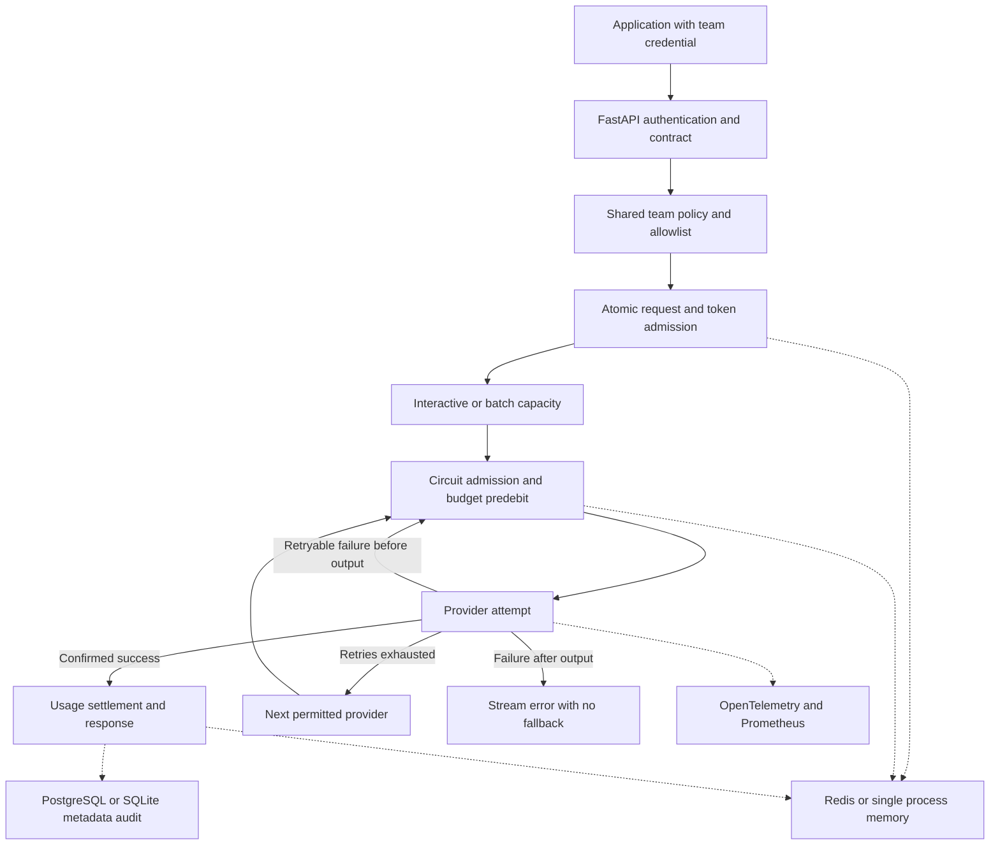

# Architecture

The gateway has a data plane for chat requests and a control plane for team policies and observed state. A caller selects a model alias; provider identity, credentials, retry policy, and prices are controlled by server configuration.

## Request lifecycle

1. Assign a server-generated request ID and extract an optional trace parent.
2. Validate the team credential using a digest comparison. Check the request's strict schema.
3. Read a policy snapshot and enforce the alias allowlist. Prepend the team's configured system prompt and revalidate size limits.
4. Admit one logical request against request and conservative token buckets atomically.
5. Acquire capacity from the selected priority pool with a bounded queue wait.
6. Skip open circuits. Predebit a budget allowance before each provider attempt.
7. Retry transient errors within both the retry count and overall request deadline. Treat authentication and request rejection as terminal.
8. Settle the attempt with reported usage or a conservative amount. Record metadata, counters, and latency.
9. Return the normalized response, or stream normalized SSE events. Complete the request audit and release capacity.

## Accounting invariants

Every attempted generation has its own reservation. Concurrent reservations cannot exceed the policy's available daily allowance at admission. Monetary values are integer micro-USD; decimal arithmetic rounds fractional cost upward.

Successful calls with usable token metadata settle to configured input and output prices. Missing usage, transport failures, ambiguous server errors, interrupted streams, and abandoned requests retain their full attempt estimate. Explicit rate-limit, authentication, and validation rejections settle to zero because the response reports a rejection rather than a completion. This is an operational accounting policy, not a provider invoice.

Settlement is idempotent. A retry cannot refund the same reservation twice. A worker crash leaves the predebit in place. There is no automatic refund of uncertain failed attempts. Investigate against provider billing before changing the ledger.

The input estimate is UTF-8 bytes plus framing allowances; output planning uses `max_tokens`. It is intentionally conservative for the supported plain-text protocol but is not a universal tokenizer proof. Provider-reported overages are recorded even if they push the ledger above the cap. Incorrect prices, provider violations, hidden fees, or lost persistence can invalidate financial assumptions.

The rate limit's token allowance is charged per logical request using the planning estimate. It is not a measured, provider-wide TPM limiter across all retries. Rejected admission consumes neither request nor token allowance; an admitted request keeps its allowance even if later rejected for queue capacity or budget.

## Streaming invariants

The adapter normalizes compatible SSE, Anthropic SSE, and Ollama NDJSON into typed events. The service commits to a provider once it yields output. It never concatenates a fallback model's output after a partial response.

The HTTP endpoint runs the service generator on a dedicated producer task and uses a bounded queue for delivery. This preserves tracing and timeout context ownership when Starlette consumes the response on another task. Prefetching allows quota and initial provider failures to return an ordinary HTTP error before `200` headers are sent.

After headers are sent, a failure is represented by an SSE error payload followed by `[DONE]`. Clients must inspect error payloads; a `200` streaming status alone is not proof of completion. Cancellation cancels the producer, closes the upstream iterator, and retains conservative accounting.

## State ownership

| State | Owner | Persistence and scope |
| --- | --- | --- |
| Team identity and provider definitions | YAML plus secret environment variables | Loaded at process startup |
| Mutable team policy | Memory or Redis | Memory disappears on restart; Redis policy survives until removed |
| Rate buckets | Memory or Redis | Atomic lock locally; Lua atomically checks both buckets in Redis |
| Daily spending and reservations | Memory or Redis | UTC day ledger; Redis keys retained for three days |
| Circuit state | Gateway worker | Per-provider, per-worker; one owned half-open probe |
| Priority capacity | Gateway worker | Separate interactive and batch semaphores |
| Request and attempt metadata | PostgreSQL or SQLite WAL | PostgreSQL is shared; SQLite is a local alternative. No prompt or completion bodies. |
| Metrics | Worker registry | Counters restart with the worker; authoritative spend is the shared ledger |

## Scaling and failure behavior

Redis failure closes admission; the service does not silently switch to memory. Redis scripts use its server time for rate refill and hash-tag related keys for single-slot atomicity. A single Redis instance remains a failure domain; high availability and backup recovery are deployment responsibilities.

Policies changed through the admin API affect subsequent policy snapshots. In-flight requests retain their snapshot. Startup seeding does not overwrite a Redis policy previously changed by an administrator. Provider definitions and credentials require a restart.

The reference stack is a single-worker service. Horizontal scaling requires shared Redis, explicit per-worker Prometheus scraping or a supported multiprocess setup, and centralized audit storage. Circuit decisions and priority capacity intentionally remain local to each worker.

Provider health is passive, based on actual attempts and circuit state. Readiness checks both the control-plane store and audit storage, not model quality or end-to-end provider availability. The service does not issue paid background health generations.

## PostgreSQL audit lifecycle

`AuditStore` defines `write`, `recent`, `health`, and `close`. `open_audit` selects
SQLite or PostgreSQL using `GATEWAY_AUDIT_BACKEND`. Selecting PostgreSQL requires
`DATABASE_URL`; there is no silent SQLite fallback. An explicit test `audit_path`
continues to select an isolated SQLite file.

`PostgresAuditLog` uses SQLAlchemy's async pool and Psycopg 3. A short transaction
commits each event; no database connection is held while waiting for model output.
`audit_events` stores typed correlation fields and a JSONB metadata payload.

Alembic creates the schema in a separate migration step. Startup only checks that
the table can be queried. Compose waits for PostgreSQL health, then a successful
one-shot migration, before starting the API. `AsyncExitStack` closes pools and clients
even when later startup steps fail. On Windows an explicit SelectorEventLoop factory
is used because Psycopg async connections do not support ProactorEventLoop.

Runtime request/attempt audit remains best effort: an audit outage is logged but
does not discard a valid, already generated reply. Readiness becomes unhealthy,
but a direct caller can still reach a running API; this is not a lossless compliance
audit system. Admin policy changes require the intent write before applying policy.
Redis and PostgreSQL are not one distributed transaction.
